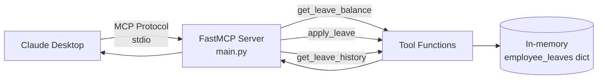

# Leave Management MCP Server

**Objective:** Build your first MCP (Model Context Protocol) server that exposes leave-management tools to Claude Desktop.

**Level:** Intermediate  
**Original source:** `bode_casics_aigen/GenAI_Leave_Management_APP`

---

## Architecture



---

## Tools Exposed

| Tool | Description |
|------|-------------|
| `get_leave_balance` | Check remaining leave days for an employee |
| `apply_leave` | Apply for specific dates (deducts balance) |
| `get_leave_history` | Retrieve leave history |
| `get_greeting` | Personalized greeting resource |

---

## How to Run (Claude Desktop)

1. Install [Claude Desktop](https://claude.ai/download).
2. Install uv: `pip install uv`
3. In this folder:
   ```bash
   uv init
   uv add mcp
   uv run mcp install main.py
   ```
4. Fully quit and restart Claude Desktop.
5. You should see the LeaveManager tools available.

---

## Example Queries in Claude

- "How many leave days does E001 have?"
- "Apply leave for E001 on 2025-04-17 and 2025-04-18"
- "Show leave history for E001"

---

## Learning Outcomes

- Creating an MCP server with FastMCP
- Defining tools with type hints and docstrings
- In-memory state management
- Installing and using the server inside Claude Desktop

---

**Note:** This is a learning example with mock data. For production you would replace the dict with a real database.
