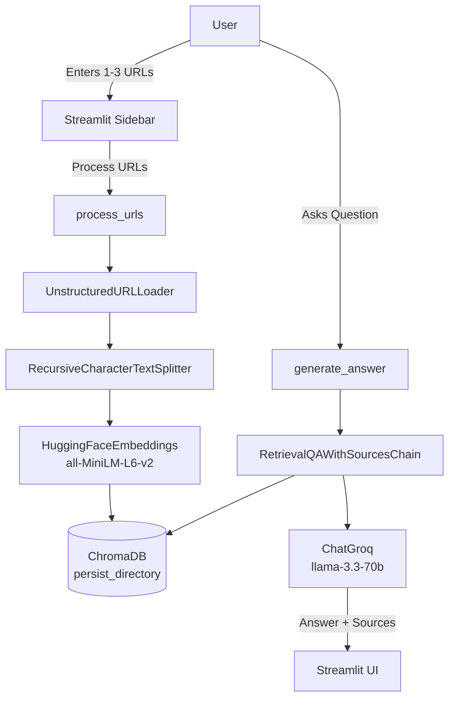

# Real Estate Research Tool

**Objective:** Build a Streamlit application that loads news article URLs, embeds them into ChromaDB, and answers questions using RAG with source citations.

**Level:** Medium  
**Original source:** `bode_casics_aigen/GenAI_Exercise5`

---

## Architecture



---

## Files in this folder

| File | Purpose |
|------|---------|
| `main.py` | Streamlit UI |
| `rag.py` | Loading, chunking, embedding, retrieval, generation |
| `prompt.py` | Custom prompt templates |
| `requirements.txt` | Dependencies |

> Note: Full `rag.py` is available in the original repo. Core logic is documented above.

---

## How to Run

```bash
cd 04-projects/real-estate-rag
python -m venv .venv
source .venv/bin/activate
pip install -r requirements.txt

# Create .env
echo "GROQ_API_KEY=your_key_here" > .env

streamlit run main.py
```

1. Enter 1–3 news URLs in the sidebar and click **Process URLs**.
2. Ask a question in the main area.
3. See the answer + source URLs.

---

## Key Concepts Learned

- UnstructuredURLLoader for web content
- Recursive character text splitting
- Hugging Face embeddings + Chroma persistence
- RetrievalQAWithSourcesChain
- Streamlit multi-step UI with status feedback

---

## Example URLs (from original tutorial)

- https://www.cnbc.com/2024/12/21/how-the-federal-reserves-rate-policy-affects-mortgages.html
- https://www.cnbc.com/2024/12/20/why-mortgage-rates-jumped-despite-fed-interest-rate-cut.html
